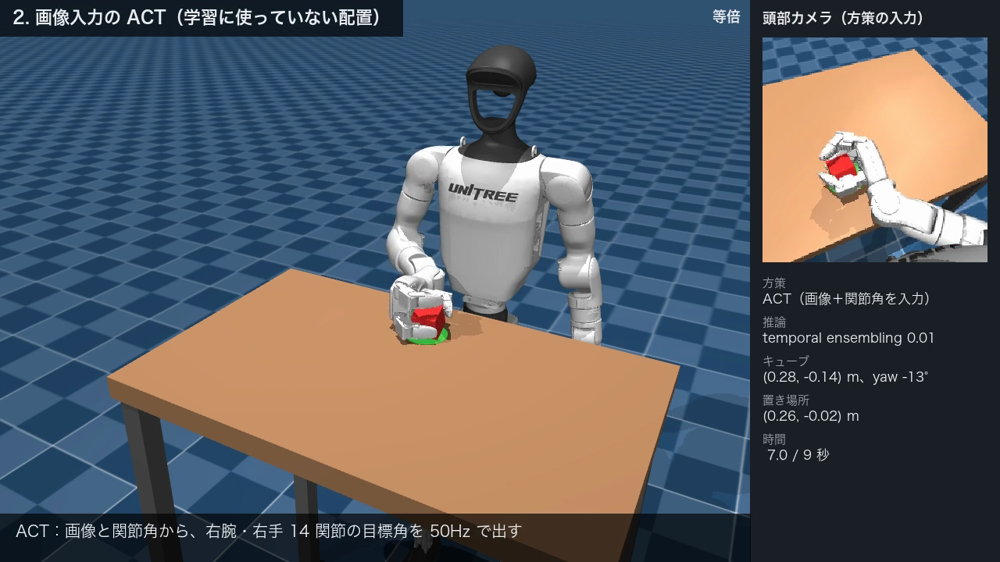
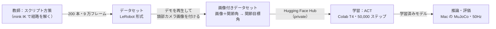

# 最終課題レポート：Unitree G1 のピック＆プレースを画像入力の模倣学習（ACT）で実現する

Physical AI 応用1講座 最終課題「AI×ロボティクスによる創造的タスクの実現」



## 1. 概要

人型ロボット Unitree G1 の上半身を MuJoCo でシミュレーションし、**机の上の赤いキューブを右手でつかみ、緑の円盤（置き場所）の上に置く**タスクを、
模倣学習の手法 **ACT（Action Chunking with Transformers）** で学習させた。

- 学習した方策の入力は、**頭部カメラの画像（224×224）と右腕・右手の関節角（14）だけ**。キューブ・置き場所の座標は与えない。
  画像から位置を読み取り、右腕 7 関節・右手 7 関節の目標角を 50Hz で出す。
- 教師データは人の操作ではなく、IK（逆運動学）で経路を解くスクリプト方策で作った。キューブと置き場所はランダムに置き、200 本作った。
- 学習に使っていない 50 配置で、**最大 47/50（94%）成功**した。キューブ・置き場所の座標を直接与えたモデル（最大 43/50）と同程度以上の成功率になった。

| 項目 | 内容 |
|---|---|
| ロボット | Unitree G1（MuJoCo Menagerie の `g1_with_hands`）。下半身は固定し、右腕 7 関節と Dex3 ハンド 7 関節を動かす |
| シミュレータ | MuJoCo 3.15（Mac M1 で実行） |
| 教師（デモ生成） | mink 1.3（IK）によるスクリプト方策 |
| AI | LeRobot 0.6.1 の ACT（ResNet18 ＋ Transformer）。Google Colab の T4 GPU で学習し、Mac で推論した |
| コード | https://github.com/t-snd/g1_manip （`main` ブランチ） |

## 2. 目的

- **カメラ画像だけを手がかりにした物体操作**を、模倣学習でどこまでできるか確かめる。実機では物体の正確な座標は得られないので、
  座標を渡さず画像から読ませることにした。
- 人の操作なしで質の良いデモを大量に作り、**データ生成 → 学習 → 推論 → 評価 → 失敗の原因の分析**を一通り自分で回す。
- 成功率を測るだけでなく、**方策が本当に画像を見て動いているのか、どこで・なぜ失敗するのか**を実験で確かめる。

## 3. システム構成



| 段階 | 内容 | コマンド |
|---|---|---|
| シーン | G1 のモデルから脚・腰の関節を取り除き、机・キューブ・置き場所のシーンに組み込む。頭部カメラは胴体に付ける | `scene` |
| 教師デモ | キューブの位置・向きと置き場所をランダムに決め、IK で手先の経路を解いて実行する。成功したデモだけを保存する | `demo`・`generate` |
| 画像付与 | 保存したデモを同じ初期状態から再生し、各ステップで頭部カメラの画像を描いて加える | `add-images` |
| 学習 | Colab のノートブック（`notebooks/train_act_pick_img_colab.ipynb`）で `lerobot-train` を動かす | — |
| 評価 | 学習に使っていないシードで 50 配置を動かし、成功率と失敗の内訳を出す | `eval` |
| 分析 | 学習データとの近さ、教師・最近傍リプレイとの比較、GUI で任意の配置を試す | `analyze`・`gui` |
| 動画 | 提出用の紹介動画を作る | `showcase` |

コマンドはすべて `python -m g1_manip <コマンド>` で実行する（詳しくは [README.md](README.md)）。

## 4. 実装

### 4.1 タスクと成功の判定

- キューブ（一辺 4.5cm）の初期位置は x 0.22〜0.38m、y −0.23〜−0.07m、向きは ±30° でランダムに決める。
  置き場所は x 0.22〜0.38m、y −0.05〜+0.05m とし、キューブとは 10cm 以上離す。
- 1 エピソードは 9 秒（450 ステップ）。最後のステップで次の条件をすべて満たせば成功とする。
  - キューブの中心が置き場所から xy で 3cm 以内にある
  - キューブが机の上に平らに置かれている
  - キューブが静止している
  - 手がキューブから離れている
- 把持は接触の物理で行う。キューブを手に固定するような疑似把持は使っていない。

### 4.2 教師（スクリプト方策）

手先の経路は次の区間をつないで作る。各区間は min-jerk 補間で、全体で約 8 秒になる。

1. キューブの上に移る
2. 横まで下ろす
3. 手のひらの法線方向に差し込む
4. 指を閉じる
5. 10cm 持ち上げる
6. 置き場所の上へ運ぶ
7. 下ろす
8. 指を開く
9. 手を退避させる

各ステップの手先の目標を mink の IK で関節角に直す。

### 4.3 データセット

- 教師で 200 本のデモを作った（試行 201 回のうち 200 回成功）。
- 各デモを同じ初期状態から再生し直し、頭部カメラの RGB 画像（224×224）を各ステップに付けた。
  学習データには `observation.state`（関節角 14）、`observation.images.head`、`action`（関節目標角 14）だけを入れ、キューブの座標は入れていない。
- 比較のため、画像の代わりにキューブ・置き場所の座標（真値）を入力にしたデータセットも作った。動きは画像付きのものとまったく同じである。

### 4.4 学習（ACT）

- LeRobot 0.6.1 の ACT を使った。画像は ImageNet で事前学習した ResNet18 で特徴に変え、Transformer で関節角と合わせる。
  出力は 100 ステップ（2 秒）分の行動をまとめた「行動チャンク」になる。
- Google Colab の T4 で 50,000 ステップ学習した（batch 64、学習率 1e-5、その他は ACT の既定値）。データセットは Hugging Face Hub の private リポジトリに置いた。

### 4.5 推論

50Hz で「頭部カメラの画像を描く → 正規化 → ACT で行動を予測 → 関節の目標角として与える → 物理を 1 周期進める」を繰り返す。
予測した 100 ステップのチャンクの使い方として、次の 3 つを比べた。

- **100 ステップごとに予測**（既定）：チャンクを最後まで実行してから予測し直す
- **temporal ensembling**：毎ステップ予測し、重なった過去の予測を重み付きで平均する（ACT 論文の方法、係数 0.01）
- **10 ステップごとに予測**：チャンクのうち 10 ステップだけ実行して予測し直す

## 5. 結果

### 5.1 成功率（学習に使っていない 50 配置、シード 100000〜100049）

| 推論の条件 | 画像入力 | 参考：座標の真値を入力 |
|---|---|---|
| 100 ステップごとに予測 | **45/50（90%）** | 43/50（86%） |
| temporal ensembling（係数 0.01） | **47/50（94%）** | 42/50（84%） |
| 10 ステップごとに予測 | 0/50（0%） | 38/50（76%） |

- 100 ステップごとに予測する条件と temporal ensembling では、画像入力のモデルは、キューブの座標を与えなくても、座標を与えたモデルと同程度以上に成功した。
- temporal ensembling では、条件の中で最も高い 47/50 になった。座標入力のモデルで失敗が多かった奥側（x ≥ 0.34m）でも 10/11 成功した。
  ただし毎ステップ予測するので、推論に 1 ステップ平均 33ms かかる（Mac M1 の MPS）。
- 10 ステップごとに予測すると、画像入力のモデルは 1 回も成功しなかった。原因は 5.3 で調べた。

### 5.2 方策は本当に画像を見ているか

GUI で試すと、学習データの範囲の外に置いたキューブも運べることがあった。丸暗記ではなく画像から位置を読んでいるのかを、次の実験で確かめた。

- **入力の確認**：方策に渡る入力は `observation.state` と `observation.images.head` の 2 つだけで、座標の真値は含まれていない。
- **画像だけをずらす実験**：シミュレーションの物体はそのままにして、頭部カメラの画像の中だけで置き場所の円盤を 4〜6cm ずらした。
  するとロボットは、ずらした先にキューブを置いた。置いた位置と画像の中の円盤の差は 0.1〜0.9cm だった。
  本物のキューブを視野の外に退避させ、画像の中だけにキューブを描いた実験でも、手の軌跡は本物のキューブがあるときとほぼ同じだった
  （5 配置、持ち上げる前までの差は最大 0.7cm）。
  - この 2 つの結果から、方策は画像から物体の位置を読んで動いていると考えられる。
  - ただし、本物のキューブを置いたまま画像の中だけキューブを 6cm ずらした実験では、x 方向にずらしたときは手もずれた先に向かった
    （画像のキューブとの差 0.8cm）が、y 方向では向かわなかった（差 8.0・8.4cm）。画像の中と本物のキューブが食い違う状況では、常に画像に従うわけではない。
- **学習範囲の外の配置**：範囲の外にキューブや置き場所を置いた 8 配置を試した。キューブ・置き場所は 3〜4cm 外し、キューブの向きは学習範囲の外の 40° にした。
  - 方策は 4 配置で成功した。成功したのは、キューブを手前・右に外した配置、向きを 40° にした配置、置き場所を手前に外した配置である。
  - 教師は 8 配置すべてで成功するので、失敗の原因は腕の届く範囲ではない。
  - 外した距離はどれも 3〜4cm で、各配置 1 回ずつなので、距離の影響は調べられていない。今回の 8 配置では、成否は外した方向で分かれた。
    範囲の外への汎化は、方向によっては効く程度と言える。

### 5.3 失敗の原因の分析：10 ステップごとに予測すると止まる

10 ステップごとに予測すると、50 配置中 47 配置でキューブを持ち上げられなかった（残る 3 配置は持ち上げたが、正しく置けなかった）。
調べた 5 配置では、手は遅くとも 1.5 秒には止まり、その後ほとんど動かなかった。止まる位置は 2 通りあった。

- 2 配置：キューブの横の「差し込む直前の位置」（キューブまで xy で約 13cm、天板から約 5cm）
- 3 配置：キューブの上の「下ろす前の位置」（天板から約 14cm）

原因を次の実験で絞り込んだ（画像入力。配置の数は表のとおり）。1〜2 行目は止まった姿勢から調べた実験、3〜5 行目は止まる型を区別せずに行った実験である。

| 実験 | 結果 |
|---|---|
| 止まった姿勢（5 秒目）から予測したチャンクの中身（3 配置） | 差し込む直前で止まった 2 配置では、最初の 10 ステップはあまり進まず（13.9→13.5cm、14.3→12.9cm）、20〜40 ステップ目で差し込んで（5cm まで近づく）指を閉じる。下ろす前で止まった 1 配置は、近づいた後に離れていく予測だった |
| 止まった姿勢から、100 ステップのチャンクを丸ごと実行（同じ 3 配置） | 差し込む直前で止まった 2 配置は、差し込んで約 10.5cm 持ち上げた（その後の置き方は失敗）。残る 1 配置は持ち上げられなかった |
| 予測し直す間隔を変える（5 配置） | 10 ステップ 0/5、20 ステップ 4/5、30 ステップ 5/5、50 ステップ 5/5 |
| 開始直後（〜1 秒）だけ 10 ステップごとに予測（5 配置） | 5/5。開始時に手がキューブを隠していることは原因ではない |
| 教師の軌跡上の観測から予測（5 配置 × 3 時刻） | 差し込みを始める時刻を教師に近い値で予測できる（教師 19・9・3 ステップ後に対し、画像入力 15〜19・3〜8・3） |

- 結論として、差し込む直前で止まった配置では、止まった姿勢から予測すると方策は「約 20 ステップ待ってから差し込む」チャンクを出す。
  10 ステップごとに予測し直すと待つ部分しか実行されず、観測が変わらないので、同じ予測を繰り返して止まり続ける（固定点）。
- 下ろす前の位置で止まる型（調べた 5 配置中 3 配置）の仕組みは調べていない。同じ種類の固定点の可能性はあるが、確かめていない。
- 教師は区間の境目で手が一瞬止まるだけで、差し込む直前の姿勢で静止し続ける区間は無い。そのため学習データには、その姿勢に留まっている状態がほとんど無い。
  方策は静止した姿勢を「まだ下りている途中」と読んでいると考えられる（推測）。
- 推論の設定で避けるには、予測し直す間隔を 30 ステップ以上にするか、temporal ensembling を使えばよい。
  間隔が 20〜50 ステップの結果は 5 配置しか試していない。座標入力のモデルの 10 ステップでの失敗（12 件）が同じ仕組みかどうかは調べていない。

## 6. 工夫した点

1. **頭部カメラに映ることを前提にした把持の設計**
   - 上からつかむと、頭部カメラから見て手がキューブを隠す。そこで、手のひらを立てて横から差し込み、親指と中指で挟む把持にした。
   - 教師の IK には次の 3 つを入れた。
     - 手先の姿勢を 3 軸とも合わせる
     - 腕と胴体の衝突を避ける
     - 手の向きの候補を IK で届くか確かめてから選ぶ
2. **模倣しやすい教師データ**
   - IK の解は、肘の位置の取り方などが急に入れ替わり、1 ステップで最大 0.34rad 跳ぶことがあった。
     これを、全関節の 1 ステップの変化を同じ比率で 0.05rad 以下に縮めることで抑えた。観測から行動への写像が急に変わる所を作らないためである。
   - 指を閉じる前に手がキューブを押したデモは、たまたま成功しても保存しないようにした。
3. **画像入力と座標入力の公平な比較**
   - 画像付きのデータは、座標入力用のデモを同じ初期状態から再生して作った。動きは完全に同じで、違いは入力だけである。
   - 再生した関節角・キューブの位置が元と一致することを確かめた。
4. **Colab の無料枠で学習するための高速化**
   - LeRobot の既定のデータ読み込みは、1 サンプルごとに 100 ステップ分の行が要るので遅く、画像付きでは 1 サンプル約 131ms かかった。
   - 学習用のラッパーで読み込みを差し替え、約 1.5ms にした。取り出す値が元の実装と一致することは、試作データの 3,600 サンプルで確かめた。
   - ランタイムが切断されても、保存が最後まで終わっているチェックポイントから再開できるようにした。
5. **評価の信頼性の確保**
   - 評価のシードは学習データと重ならないようにした。
   - 実行前に次の点を自動で照合するようにした。
     - 関節の並び順が学習時と同じであること（学習データと同じシードでリセットした観測を、保存した最初のフレームと比べる。違えば評価を止める）
     - モデルの入出力の形が環境と合うこと（違えば止める）
     - モデルの正規化統計が学習データと一致すること（違えば警告を出す）
   - 失敗は「持ち上げていない」「置き位置のずれ」などの内訳に分けて記録した。
6. **「うまくいった」で終わらせない検証**
   - 汎化が高く見えたので、画像だけをずらす実験で、方策が画像を見ていることを確かめた（効かなかった条件も 5.2 に書いた）。
   - 0/50 だった条件は、止まる仕組みを実験で特定した。

## 7. 課題と今後

- 10 ステップごとに予測すると止まる問題は、推論の設定で避けているだけで、方策そのものは直していない。
  学習側で直すには、次の方法が考えられる。
  - 速度や直前の行動を観測に加える
  - デモの途中に静止する区間をランダムに入れる
  - 方策が止まった状態に教師の行動を付けて学習データに足す（DAgger）
- 学習範囲の外への汎化は、方向によっては効かない。範囲を広げたデータや、データ拡張で改善できるか試したい。
- 画像入力のモデルは、頭部カメラの描画を含めて 1 ステップ約 60ms かかり、実時間（20ms）に追いつかない。
  GUI での再生は実時間より遅い。動画は録画した結果を等倍で再生している。
- シミュレーションのみで、実機では試していない。

## 8. 提出物

| 提出物 | 場所 |
|---|---|
| 動画（2 分 20 秒、**等倍**） | `outputs/showcase.mp4`（`python -m g1_manip showcase` で作る。サイズが大きいので git には入れていない） |
| コード一式 | https://github.com/t-snd/g1_manip （`main`）。環境構築と各コマンドは [README.md](README.md) |
| 学習ノートブック | `notebooks/train_act_pick_img_colab.ipynb`（画像入力）、`notebooks/train_act_pick_colab.ipynb`（座標入力） |
| レポート | このファイル（`REPORT.md`） |

動画の構成は次のとおり。各エピソードは実際に動かした結果をそのまま録画している。

1. タイトル
2. 作ったもの
3. 教師デモ
4. 画像入力の ACT（学習に使っていない 5 配置）
5. 学習範囲の外の配置（範囲の外の 8 配置のうち、成功した 4 配置から 3 つを選んだ）
6. 失敗例（10 ステップごとに予測すると止まる）
7. 成功率の表

再現手順（学習済みモデルを `outputs/act_g1_pick_img_v1/pretrained_model/`（画像入力）と `outputs/act_g1_pick_v1/pretrained_model/`（座標入力）に置いた状態で）。
紹介動画の成功率の表は、両モデル × 3 条件の評価結果（計 6 個の JSON）から読むので、先に評価を回す：

```bash
for m in act_g1_pick_img_v1 act_g1_pick_v1; do
  .venv/bin/python -m g1_manip eval --task pick --policy-path outputs/$m/pretrained_model
  .venv/bin/python -m g1_manip eval --task pick --policy-path outputs/$m/pretrained_model --temporal-ensemble 0.01
  .venv/bin/python -m g1_manip eval --task pick --policy-path outputs/$m/pretrained_model --n-action-steps 10
done
.venv/bin/python -m g1_manip showcase                    # 紹介動画（M1 で 12〜15 分）
.venv/bin/python -m g1_manip gui --policy-path outputs/act_g1_pick_img_v1/pretrained_model   # 配置を変えて試す
```

## 9. 使用したツール

- シミュレーション：MuJoCo 3.15、MuJoCo Menagerie（Unitree G1）
- IK：mink 1.3
- 学習・推論：LeRobot 0.6.1（ACT）、PyTorch 2.10、Google Colab（T4）、Hugging Face Hub
- 開発の補助：Claude Code（コードの作成・検証）
