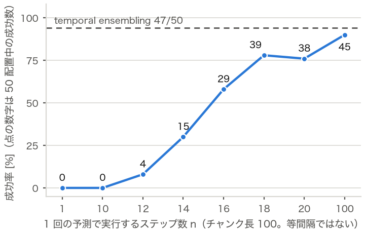

# Unitree G1 のピック＆プレースを画像入力の模倣学習（ACT）で実現する

Physical AI 応用1講座 最終課題 ／ コード：https://github.com/t-snd/g1_manip ／ 動画（限定公開）：https://youtu.be/Lnddjy7fTtA

## 1. タスク概要

- タスク：MuJoCo 上の Unitree G1（上半身のみ）が、机の上のキューブ（一辺 4.5cm）を右手でつかみ、緑の円盤の上に置く。キューブ（x 0.22〜0.38m、y −0.23〜−0.07m、向き ±30°）と置き場所は毎回ランダムに置く。9 秒後に「置き場所から 3cm 以内・平ら・静止・手が離れている」をすべて満たせば成功とする。把持は接触の物理で行う（疑似把持なし）。
- 入出力：入力は頭部カメラの画像（224×224）と、右腕 7・右手 7 の関節角（14）。出力は 14 関節の目標角（50Hz）。
- モデル：LeRobot 0.6.1 の ACT。画像を ResNet18（ImageNet 事前学習）で特徴にし、Transformer（CVAE）で関節角と合わせて、100 ステップ（2 秒）分の行動（行動チャンク）をまとめて出す。

## 2. 学習方法

- データセット：教師は、mink の IK で手先の経路を解くスクリプト方策（上へ移る → 下ろす → 横から差し込む → 閉じる → 持ち上げて運ぶ → 置く。各区間は min-jerk 補間）。ランダムな配置で 201 回試し、成功した 200 本（9 万フレーム）を保存した。これを同じ初期状態から再生して頭部カメラの画像を付け、LeRobot 形式にした。
- 学習条件：Google Colab（T4）で 50,000 ステップ。batch 64、学習率 1e-5、チャンク長 100、KL 重み 10（ほかは ACT の既定値）。5,000 ステップごとに保存した。

## 3. 推論結果

学習に使っていない 50 配置（全条件で同じ配置）での成功数（1 万ステップは学習途中のチェックポイント）：

| 推論の条件 | 画像入力・5 万ステップ | 画像入力・1 万ステップ | 参考：座標の真値を入力 |
|---|---|---|---|
| temporal ensembling（毎ステップ予測して重み付き平均、係数 0.01） | 47/50（94%） | 42/50 | 42/50 |
| 100 ステップごとに予測（チャンクを最後まで実行） | 45/50（90%） | 27/50 | 43/50 |

- 座標を与えなくても、座標入力のモデルと同程度以上に成功した。
- 学習を 1 万 → 5 万ステップと進めると、主に置き位置のずれが減った（置き誤差の中央値：temporal ensembling 1.66 → 0.61cm、100 ステップごと 2.81 → 0.96cm）。
- 5 万ステップ・temporal ensembling の失敗 3 件は、置き位置のずれ 2 件と持ち上げられない 1 件。推論は 1 ステップ平均 33ms（Mac M1）。

## 4. 考察：アクションチャンクの実行長と失敗の原因

チャンクのうち n ステップだけ実行して予測し直すと、n ≤ 10 では 50 配置すべてで失敗し、n 14〜18 で成功が急に増えた（右図）。n10 の失敗 50 件のうち 47 件は、手が途中で止まってキューブを持ち上げなかった。

### 確かめたこと
- 止まる場所は、approach（最初に手を運ぶ区間）の出だし（24 配置）と差し込む直前（18 配置）が大半
- どちらも、教師が min-jerk で静止からゆっくり動き出す区間である。出だしでは、教師の関節は最初の 10 ステップで 0.04rad しか動かない。止まった状態で予測し直すと、チャンクの始点が現在の姿勢より少し手前に戻り、10 ステップ実行してもほぼ元の姿勢に戻る。
- 最初の 10〜15 ステップを教師に動かしてもらうと、出だしは抜けた（3 配置）。

### 推定原因
- ゆっくり動き出す区間では、短い n で実行する分の前進が、予測のずれ（t=0 で約 0.09rad）に埋もれる。そのため同じ計画を繰り返すと考えられる。

## 5. 工夫した点

1. カメラから見える把持：上からつかむと手がキューブを隠す。そこで、手のひらを立てて横から差し込み、親指と中指で挟む把持にした。
2. 模倣しやすい教師：IK の解は 1 ステップで最大 0.34rad 跳ぶことがあった。全関節を同じ比率で縮めて、0.05rad 以下にした。指を閉じる前にキューブを押したデモは捨てた。
3. G1の下半身（腰軸含む）は固定：腕の制御の難易度が上がるためまずは固定で実施。